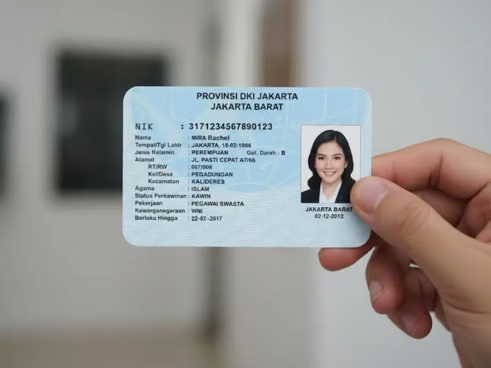
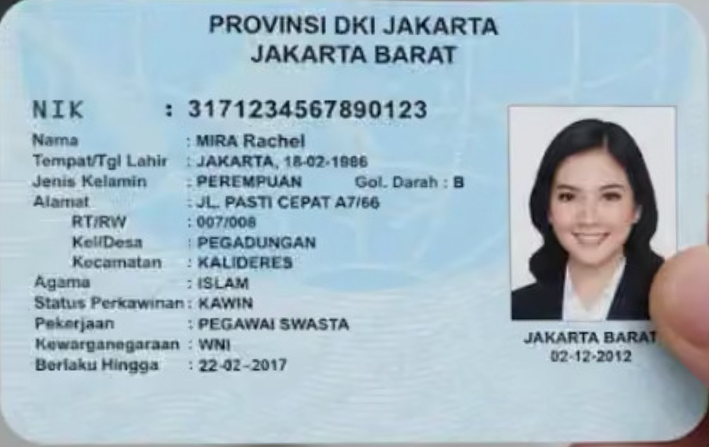

# doksli-ocr

OCR (*optical character recognition*, pengenalan teks dari gambar) untuk **KTP** dan **NPWP** Indonesia yang
berjalan **sepenuhnya di browser**. Foto dokumen tidak pernah dikirim ke server, karena seluruh prosesnya, dari
mendeteksi kartu sampai mengambil isi setiap kolom, berjalan di perangkat pengguna dengan
[onnxruntime-web](https://onnxruntime.ai/) (WebAssembly).

*Offline OCR for Indonesian ID cards (KTP) and tax cards (NPWP), running fully client-side.*

```js
import { createOcr } from "doksli-ocr";

const ocr = await createOcr();
const result = await ocr.recognize(file);   // File dari <input type="file">
console.log(result.docType, result.fields, result.needsReview);
```

## Contoh

Foto KTP contoh buatan AI dengan data rekaan, dipotret miring dan dipegang tangan (828×621 piksel), dibaca dengan
`recognize()` lalu `cardCanvas()`:

| Foto masukan | `result.cardCanvas()` (1024×646) |
|---|---|
|  |  |

Hasil `recognize()` di browser (onnxruntime-web WASM, 1 *thread*). Kolom `lines` dan `timeMs` tidak ditampilkan, dan
angka keyakinan serta koordinat dibulatkan:

```json
{
  "docType": "ktp",
  "fields": {
    "nik": "3171234567890123",
    "nama": "MIRA Rachel",
    "tempat_lahir": "JAKARTA",
    "tanggal_lahir": "18-02-1986",
    "jenis_kelamin": "PEREMPUAN",
    "gol_darah": "B",
    "alamat": "JL. PASTI CEPAT A7/66",
    "rt_rw": "007/006",
    "kel_desa": "PEGADUNGAN",
    "kecamatan": "KALIDERES",
    "agama": "ISLAM",
    "status_perkawinan": "KAWIN",
    "pekerjaan": "PEGAWAI SWASTA",
    "kewarganegaraan": "WNI",
    "berlaku_hingga": "22-02-2017",
    "provinsi": "DKI JAKARTA",
    "kabupaten_kota": "JAKARTA BARAT"
  },
  "confidence": {
    "nik": 1.0, "nama": 0.83, "tempat_lahir": 1.0, "tanggal_lahir": 0.99, "jenis_kelamin": 1.0, "gol_darah": 1.0,
    "alamat": 0.89, "rt_rw": 0.51, "kel_desa": 0.99, "kecamatan": 0.98, "agama": 1.0, "status_perkawinan": 0.99,
    "pekerjaan": 1.0, "kewarganegaraan": 0.98, "berlaku_hingga": 1.0, "provinsi": 1.0, "kabupaten_kota": 1.0
  },
  "needsReview": ["alamat", "nama", "nik", "rt_rw", "tanggal_lahir"],
  "issues": ["nik_tanggal", "nik_vs_tanggal_lahir"],
  "mode": "warp",
  "imageSize": { "width": 828, "height": 621 },
  "quad": [[210.0, 147.4], [628.1, 145.8], [624.3, 420.5], [206.3, 416.2]]
}
```

Enam belas dari tujuh belas kolom terbaca sesuai yang tercetak. RT/RW terbaca `007/006`, padahal tercetak `007/008`,
tetapi keyakinannya hanya 0,51 sehingga kolom itu masuk `needsReview`. NIK contoh ini bukan NIK yang sah, karena
digit tanggalnya (`45-67-89`) bukan tanggal yang valid. Validator menangkapnya sebagai `nik_tanggal`, dan karena
tanggal lahir di kartu tidak cocok dengan NIK, keduanya juga ditandai. Nama dan alamat ditandai karena keyakinan
salah satu karakternya di bawah 0,95. Pada pemakaian nyata, kolom-kolom di `needsReview` inilah yang perlu disorot di
form agar diperiksa pengguna.

## Fitur

- **KTP**: NIK, nama, tempat dan tanggal lahir, jenis kelamin, gol. darah, alamat, RT/RW, kel/desa,
  kecamatan, kabupaten/kota, provinsi, agama, status perkawinan, pekerjaan, kewarganegaraan, berlaku hingga.
- **NPWP** desain lama dan baru, baik 15 maupun 16 digit: NPWP, NIK, nama, alamat, KPP.
- Jenis dokumen, KTP atau NPWP, dikenali secara otomatis.
- Foto yang miring, termasuk yang berperspektif, dan foto yang terputar 90° atau 180° diluruskan otomatis oleh
  model sudut kartu.
- Validasi NIK, baik strukturnya maupun kecocokannya dengan tanggal lahir dan jenis kelamin, serta validasi format
  tanggal, RT/RW, dan NPWP.
- Koreksi dengan kamus: wilayah administrasi bertingkat, agama, status, pekerjaan Dukcapil, daftar KPP DJP.
- **Tanda "perlu dicek"** pada setiap kolom, dihitung dari keyakinan per karakter, supaya pengguna tahu kolom mana
  yang hasil bacaannya masih ragu.
- Ringan: sekitar 3 MB model ditambah sekitar 2,9 MB *runtime* WASM (terkompresi). Keduanya cukup diunduh sekali,
  lalu dapat disimpan di *cache* browser.

## Akurasi

Akurasi diukur pada data uji terpisah, yaitu 68 foto nyata (46 KTP, 22 NPWP) milik orang yang berbeda dengan
pemilik data latih. Sebuah kolom dihitung benar jika isinya persis sama dengan label.

| Kolom | Benar | Kolom | Benar |
|---|---|---|---|
| KTP NIK | 98% | KTP provinsi / kab-kota | 98% / 100% |
| KTP tanggal lahir | 96% | KTP jenis kelamin | 100% |
| KTP pekerjaan | 98% | KTP kel/desa / kecamatan | 91% / 96% |
| KTP agama / status | 98% / 98% | KTP RT/RW | 93% |
| KTP nama | 87% | KTP alamat | 52% |
| NPWP nomor | 96% | NPWP KPP | 94% |
| NPWP nama | 73% | NPWP alamat | 32% |
| **Rata-rata semua kolom** | **90%** | | |

Kolom yang tidak ditandai "perlu dicek" (`needsReview`) benar **~97%**. Tanda itu menangkap ~3/4 kolom yang salah,
dengan menandai ~22% dari seluruh kolom, termasuk kolom yang diisi dari NIK. Nama dan alamat yang panjang adalah
bagian tersulit, walaupun kesalahannya biasanya hanya pada satu karakter, sering berupa spasi atau tanda baca. Data
ujinya kecil, jadi anggap angka ini sebagai perkiraan dan ukur ulang dengan data Anda sendiri.

### Perbandingan dengan ktp-kit

[ktp-kit](https://github.com/Khusyasy/ktp-kit) 0.2.0 adalah pustaka OCR KTP *offline* lain yang juga berbasis
onnxruntime-web. Keduanya dijalankan pada **46 foto KTP nyata** yang sama, yaitu data uji di atas yang tidak
dipublikasikan, di lingkungan yang sama: Node, onnxruntime-web WASM 1 *thread*, dan dekoder JPEG `jpeg-js`.
Aturan penilaiannya juga sama untuk keduanya:

- Isi kolom harus persis sama setelah huruf besar dan spasi dinormalkan.
- NIK dibandingkan digitnya saja.
- Agama dibandingkan dalam ejaan baku, sehingga KATHOLIK dihitung sama dengan KATOLIK.
- Provinsi, kabupaten/kota, kecamatan, dan kel/desa dihitung benar jika namanya sama atau merujuk ke kode wilayah
  yang sama, karena ktp-kit mengeluarkan nama resmi, misalnya "DAERAH KHUSUS IBUKOTA JAKARTA".

| Kolom KTP | doksli-ocr | ktp-kit 0.2.0 |
|---|---|---|
| NIK | 97,8% | 97,8% |
| Nama | 82,6% | 82,6% |
| Tempat lahir | **91,3%** | 89,1% |
| Tanggal lahir | 95,7% | 95,7% |
| Jenis kelamin | 97,8% | 97,8% |
| Gol. darah (n=39) | 84,6% | **89,7%** |
| Alamat | **52,2%** | 45,7% |
| RT/RW (n=44) | 88,6% | **93,2%** |
| Kel/desa | 89,1% | 89,1% |
| Kecamatan | 93,5% | 93,5% |
| Kabupaten/kota | 97,8% | 97,8% |
| Provinsi | **97,8%** | 95,7% |
| Agama | 93,5% | **97,8%** |
| Status perkawinan | **97,8%** | 95,7% |
| Pekerjaan | 95,7% | 95,7% |
| Kewarganegaraan | 95,7% | **97,8%** |
| Berlaku hingga (n=44) | 95,5% | **97,7%** |
| **Rata-rata per kolom** | 91,0% | **91,3%** |
| KTP yang semua kolomnya benar | **15/46** | 13/46 |
| Kolom salah yang tertangkap tanda "perlu dicek" | **79,7%** | 61,2% |
| Akurasi kolom yang tidak ditandai | **97,7%** | 96,4% |
| Kolom yang ditandai | 20,5% | **7,5%** |
| Median waktu per foto (Node, WASM 1 *thread*) | **578 ms** | 1.344 ms |
| Ukuran model ONNX | **2,95 MB** | 4,72 MB |
| Total unduhan browser (terkompresi) | ~6,5 MB (ORT WASM penuh) | **~4,9 MB** (ORT WASM ramping) |
| NPWP | **ya** | tidak |

Akurasi rata-rata keduanya setara, dengan selisih 0,3 poin atau sekitar 3 dari 855 kolom. doksli-ocr lebih sering
membaca satu kartu dengan benar seluruhnya dan lebih baik pada alamat. Tanda "perlu dicek"-nya juga menangkap lebih
banyak kesalahan, dan prosesnya 2,3× lebih cepat. ktp-kit lebih unggul pada gol. darah, RT/RW, dan agama, serta
menandai lebih sedikit kolom. Pada data validasi terpisah yang berisi 46 KTP lain, doksli-ocr mendapat 94,8%
berbanding 94,1% untuk ktp-kit.

Data uji ini juga dipakai untuk mengukur rilis doksli-ocr sebelumnya, sehingga angka doksli-ocr mungkin sedikit
optimistis. Adapun ktp-kit dilatih dengan data sintetis dan belum pernah melihat foto-foto ini. Angka di atas diambil
pada 2026-11-16 dengan ktp-kit 0.2.0, dan versi yang lebih baru bisa memberi hasil berbeda.

## Instalasi

```bash
npm install doksli-ocr onnxruntime-web
```

`onnxruntime-web` adalah *peer dependency*, artinya paket itu dipasang sendiri oleh aplikasi Anda. Versi yang sudah
diuji adalah 1.22 dan 1.31.

Model tersimpan di folder `models/` di dalam paket, sedangkan berkas WASM ada di `onnxruntime-web/dist/`. Browser
harus dapat mengambil keduanya, jadi salin keduanya ke folder publik aplikasi Anda, misalnya `public/` pada Vite,
Next.js, atau CRA:

```bash
mkdir -p public/doksli-ocr public/ort
cp node_modules/doksli-ocr/models/* public/doksli-ocr/
cp node_modules/onnxruntime-web/dist/ort-wasm-simd-threaded.{wasm,mjs} public/ort/
```

Supaya salinan itu selalu sinkron setiap kali versi paket diperbarui, tambahkan skrip berikut ke `package.json`:

```json
{ "scripts": { "postinstall": "mkdir -p public/doksli-ocr public/ort && cp node_modules/doksli-ocr/models/* public/doksli-ocr/ && cp node_modules/onnxruntime-web/dist/ort-wasm-simd-threaded.* public/ort/" } }
```

## Penggunaan

### Dengan bundler (Vite, webpack, Next.js, …)

```js
import { createOcr } from "doksli-ocr";

const ocr = await createOcr({
  modelBaseUrl: "/doksli-ocr/",   // folder berisi corners.onnx, det.onnx, rec.onnx, ...
  wasmPaths: "/ort/",              // folder berisi ort-wasm-simd-threaded.wasm
  onProgress: (file) => console.log("dimuat:", file),
});

input.addEventListener("change", async () => {
  const result = await ocr.recognize(input.files[0]);
  if (result.docType === "ktp") {
    console.log(result.fields.nik, result.fields.nama);
  }
  for (const field of result.needsReview) {
    // tandai kolom ini di form agar dicek pengguna
  }
});
```

Cukup panggil `createOcr()` **sekali**, karena pemuatan model memakan waktu sekitar 1 detik, lalu panggil
`recognize()` sebanyak yang Anda perlukan. Pada Next.js atau aplikasi SSR lain, panggil `createOcr()` hanya di
sisi klien, misalnya di dalam `useEffect` atau komponen `"use client"`.

### Tanpa bundler (import map + CDN)

```html
<script type="importmap">
{
  "imports": {
    "onnxruntime-web": "https://cdn.jsdelivr.net/npm/onnxruntime-web@1.22.0/dist/ort.wasm.min.mjs",
    "doksli-ocr": "https://cdn.jsdelivr.net/npm/doksli-ocr@0.1.0/src/index.js"
  }
}
</script>
<input type="file" id="f" accept="image/*" capture="environment">
<script type="module">
  import { createOcr } from "doksli-ocr";
  const ocr = await createOcr({ wasmPaths: "https://cdn.jsdelivr.net/npm/onnxruntime-web@1.22.0/dist/" });
  document.getElementById("f").onchange = async (e) => {
    const r = await ocr.recognize(e.target.files[0]);
    console.log(r.fields, r.needsReview);
  };
</script>
```

Jika memakai CDN, browser hanya **mengunduh model** dari sana, sedangkan fotonya tetap diproses di perangkat. Untuk
aplikasi yang harus benar-benar bisa dipakai tanpa internet, sajikan model dan berkas WASM dari server Anda sendiri,
lalu simpan keduanya di *cache* dengan *service worker*.

### Contoh di repo ini

```bash
npm install
npm run serve        # http://127.0.0.1:8080/examples/browser/
```

## API

### `createOcr(options?) → Promise<DoksliOcr>`

| Opsi | Default | Keterangan |
|---|---|---|
| `modelBaseUrl` | `models/` di dalam paket | URL folder model |
| `wasmPaths` | bawaan onnxruntime-web | URL folder berkas WASM onnxruntime-web |
| `ort` | `import("onnxruntime-web")` | modul onnxruntime-web milik aplikasi, jika Anda ingin memakai salinan sendiri |
| `numThreads` | 4 jika `crossOriginIsolated`, selain itu 1 | jumlah *thread* WASM |
| `onProgress` | tidak ada | dipanggil setiap kali satu berkas model selesai dimuat |
| `fetchOptions` | `{}` | opsi `fetch()` yang dipakai saat memuat model |

### `ocr.recognize(input, options?) → Promise<OcrResult>`

`input` dapat berupa `File`/`Blob`, `ImageBitmap`, `HTMLImageElement`, `HTMLCanvasElement`, `OffscreenCanvas`,
`HTMLVideoElement`, atau `ImageData`. Orientasi EXIF pada foto ikut diterapkan.

| Opsi | Default | Keterangan |
|---|---|---|
| `docType` | otomatis | tetapkan `"ktp"` atau `"npwp"` tanpa deteksi otomatis |
| `fallback` | `true` | jika kartu yang sudah diluruskan tidak terbaca dengan baik, foto penuh dibaca ulang |
| `maxSide` | `1600` | sisi terpanjang foto saat diproses |
| `maxInputSide` | `3200` | sisi terpanjang foto yang disimpan sebagai sumber `cardCanvas({ width })` beresolusi penuh |

Berikut contoh hasil (`OcrResult`) dengan data rekaan:

```json
{
  "docType": "ktp",
  "fields": {
    "nik": "3171014501900001", "nama": "BUDI SANTOSO", "tempat_lahir": "JAKARTA",
    "tanggal_lahir": "05-01-1990", "jenis_kelamin": "PEREMPUAN", "rt_rw": "001/002",
    "provinsi": "DKI JAKARTA", "kabupaten_kota": "JAKARTA PUSAT", "agama": "ISLAM",
    "berlaku_hingga": "SEUMUR HIDUP"
  },
  "confidence": { "nik": 1, "nama": 0.998, "rt_rw": 0.71 },
  "needsReview": ["rt_rw"],
  "issues": [],
  "mode": "warp",
  "imageSize": { "width": 1600, "height": 1200 },
  "quad": [[312, 140], [1180, 120], [1210, 680], [330, 700]],
  "lines": [{ "text": "NIK : 3171014501900001", "box": [[0, 0], [0, 0], [0, 0], [0, 0]], "score": 0.99, "probs": [] }],
  "timeMs": 420
}
```

- `fields`: isi setiap kolom dalam huruf besar, seperti yang tercetak, sedangkan NIK dan NPWP hanya berisi digit.
  Kolom yang tidak terbaca tidak muncul di objek ini.
- `confidence`: keyakinan setiap kolom, dari 0 sampai 1, diambil dari karakter dengan keyakinan terendah.
- `needsReview`: kolom yang keyakinannya di bawah `CONF_THRESHOLD` (0,95) atau gagal validasi. **Tampilkan kolom
  ini kepada pengguna supaya diperiksa**, begitu pula kolom yang kosong.
- `issues`: kode masalah dari validator, misalnya `nik_format`, `nik_vs_tanggal_lahir`, `nik_vs_jenis_kelamin`,
  `tanggal_lahir_format`, `rt_rw_format`, `npwp_format`, dan `agama_vocab`.
- `mode`: `"warp"` jika kartu terdeteksi lalu diluruskan, atau `"full"` jika teks dibaca dari foto penuh.
- `imageSize`: ukuran foto masukan setelah orientasi EXIF diterapkan, yang menjadi acuan koordinat `quad`.
- `quad`: empat sudut kartu dalam koordinat foto asli, berurutan kiri-atas, kanan-atas, kanan-bawah, kiri-bawah
  menurut posisi kartu yang tegak, atau `null` pada mode `"full"`.
- `lines`: baris teks yang terbaca, dengan kotak berkoordinat kartu 1024×646 pada mode `"warp"` dan berkoordinat
  foto asli pada mode `"full"`.
- `cardCanvas(options?)`: gambar kartu yang sudah dipotong dan diluruskan, hanya tersedia pada mode `"warp"`.
  Penjelasannya ada di bagian berikut.

Fungsi validatornya juga diekspor, yaitu `parseNik(nik)`, `checkKtp(fields)`, dan `checkNpwp(fields)`.

### Gambar kartu yang sudah diluruskan

`cardCanvas()` mengembalikan kartu yang sudah dipotong dari latarnya, diluruskan dari perspektif miring, diputar ke
posisi tegak, lalu diskalakan ke rasio kartu. Tanpa opsi, hasilnya berukuran 1024×646 dan diambil dari foto yang
dipakai pipeline, yaitu foto yang sudah diperkecil ke `maxSide`. Cara ini paling cepat dan cukup untuk pratinjau.

Jika memerlukan gambar yang lebih tajam, misalnya untuk arsip, berikan opsi `width`. Kartu akan diluruskan langsung
dari foto beresolusi penuh, yang dibatasi oleh `maxInputSide`:

```js
const result = await ocr.recognize(file);
if (result.cardCanvas) {
  const preview = result.cardCanvas();                      // 1024×646, cepat
  const arsip = result.cardCanvas({ width: "auto" });       // resolusi asli kartu di foto, tanpa diperbesar
  const kecil = result.cardCanvas({ width: 512 });          // 512×323
  arsip.toBlob((blob) => simpan(blob), "image/jpeg", 0.92); // OffscreenCanvas: arsip.convertToBlob()
}
```

| Opsi `cardCanvas` | Default | Keterangan |
|---|---|---|
| `width` | `"auto"` jika objek opsi diberikan | lebar keluaran dalam piksel, atau `"auto"` untuk memakai lebar kartu di foto |
| `height` | mengikuti rasio 1024:646 | tinggi keluaran dalam piksel |

Pada foto 4080×3060, `cardCanvas({ width: "auto" })` menghasilkan kartu sekitar 2600×1640 piksel dalam waktu kurang
dari 0,1 detik. Sudut kartu berasal dari model yang sama dengan pipeline, jadi pada foto yang sangat buram atau kartu
yang terpotong di tepi foto, potongannya bisa meleset beberapa piksel.

## Performa

| | Waktu per kartu |
|---|---|
| Laptop, 1 *thread* | ~0,5 sampai 0,6 detik |
| Laptop, 4 *thread* (*cross-origin isolated*) | ~0,35 sampai 0,4 detik |

Mode *multi-thread* hanya aktif pada halaman yang **cross-origin isolated**. Untuk itu, pasang dua *header* berikut
di hosting Anda:

```
Cross-Origin-Opener-Policy: same-origin
Cross-Origin-Embedder-Policy: require-corp
```

Tanpa kedua *header* itu, doksli-ocr tetap berjalan, hanya saja dengan 1 *thread*.

## Tips hasil terbaik

- Usahakan kartu memenuhi sebagian besar bingkai foto dan terlihat tajam. Hindari pantulan lampu atau *flash* yang
  jatuh di atas teks.
- Resolusi kamera biasa sudah cukup, karena foto akan diperkecil ke 1600 px sebelum diproses.
- Selalu tampilkan hasilnya sebagai **form yang dapat diedit**, lalu sorot kolom yang ada di `needsReview`.

## Privasi dan penggunaan yang bertanggung jawab

- Gambar diproses di memori browser, dan pustaka ini tidak mengirimkannya ke mana pun.
- Hasil OCR di sisi klien **dapat dimanipulasi** oleh pengguna. Untuk KYC (*know your customer*, verifikasi identitas
  nasabah) atau keputusan penting lainnya, periksa ulang datanya di server, baik format dan konsistensinya maupun
  kecocokannya dengan sumber resmi. Simpan datanya sesuai Undang-Undang Pelindungan Data Pribadi (UU PDP).
- Pustaka ini hanya membaca teks yang tercetak pada kartu dan tidak memeriksa keaslian dokumennya.

## Batasan

- Pustaka ini dirancang khusus untuk KTP-el dan kartu NPWP, dan belum mendukung dokumen lain.
- Alamat dan nama yang panjang adalah kolom tersulit. NPWP badan usaha dan NPWP yang berbentuk surat juga bisa
  terbaca kurang baik.
- Model dilatih secara privat dari foto sukarelawan yang sudah memberi izin. Kode dan data pelatihannya tidak
  dirilis.

## Pengembangan

```bash
npm install
npm test             # tes parser & validator (data rekaan, tanpa model)
npm run serve        # contoh di browser
```

Struktur repositori:

```
src/index.js     API publik: createOcr(), recognize()
src/ocr.js       sudut kartu, pelurusan, detektor teks (DB), pengenal teks (CTC), pipeline
src/parse.js     parser KTP/NPWP, validator, kamus, keyakinan per kolom
src/index.d.ts   definisi TypeScript
models/          corners.onnx, det.onnx, rec.onnx (bobot INT8), kamus karakter & wilayah
examples/        contoh aplikasi browser + server statis kecil
```

### Merilis ke npm (maintainer)

```bash
npm test
npm pack --dry-run          # periksa isi paket
npm login
npm publish --access public
```

Sebelum menjalankan `npm publish`, naikkan versinya dengan `npm version patch|minor|major`.

## Lisensi

[Apache License 2.0](LICENSE). Atribusi model dasar (PaddleOCR/RapidOCR, Apache-2.0) serta atribusi data dan
dependensi lainnya tercantum di [NOTICE](NOTICE).
